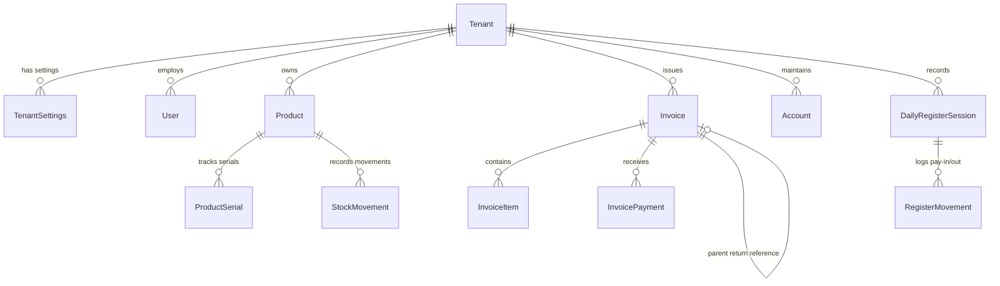

# ExpenseManager - SaaS Multi-Tenant Retail ERP & Accounting Platform

## 1. Executive Overview

**ExpenseManager** is an enterprise-grade, multi-tenant Software-as-a-Service (SaaS) Enterprise Resource Planning (ERP), Point of Sale (POS), and Accounting platform. Tailored for retail businesses, multi-branch stores, and personal accounting, it provides end-to-end operational automation—from Super Admin tenant lifecycle management to store-level POS billing, serial number tracking, unified invoicing (Sales, Purchases, and Returns), cash drawer session reconciliation, and financial ledger management.

The architecture guarantees **strict tenant isolation** through asynchronous thread-local context injection (`AsyncLocalStorage`), TypeORM entity lifecycle hooks, and robust Role-Based Access Control (RBAC).

---

## 2. Technology Stack

### Backend
- **Runtime & Framework:** Node.js (v20+ / v22+), NestJS v10 (`@nestjs/core`, `@nestjs/common`, `@nestjs/platform-express`)
- **Language:** TypeScript 5.7
- **Database & ORM:** PostgreSQL 15+, TypeORM 0.3 (`@nestjs/typeorm`, `pg`)
- **Authentication & Security:** JWT (`@nestjs/jwt`, `passport-jwt`), `bcrypt`, `class-validator`, `class-transformer`
- **Tenant Isolation:** Node.js `AsyncLocalStorage` (`TenantContext`)
- **Document & Print Generation:** PDFKit 0.20 (Branded Tax Invoices, Thermal Receipts, Account Statements)
- **File & Media Storage:** Multer DiskStorage with strict MIME validation and tenant-isolated disk paths (`/uploads/tenants/:tenantId/products/`)

### Frontend
- **Framework & Language:** React 19 (`react`, `react-dom`), React Router v7 (`react-router-dom`)
- **UI Library & Design System:** Material-UI v7 (`@mui/material`, `@mui/icons-material`, `@emotion/react`, `@emotion/styled`)
- **State Management & Forms:** React Context API (`AuthContext`, `TenantContext`), React Hook Form v7 (`react-hook-form`)
- **HTTP Client:** Axios v1.13 with request/response interceptors, automatic multipart boundary management, and token refresh
- **Barcode & Hardware Scanning:** 
  - USB / Bluetooth barcode hardware emulation (global non-focused keyboard scanner listener)
  - Mobile/Tablet Camera scanning (`html5-qrcode`)
  - Barcode label generation & printing (`jsbarcode`)
- **Analytics & Data Visualization:** Chart.js v4, `react-chartjs-2`, `date-fns`

---

## 3. Repository Architecture

```
ExpenseManager/
├── backend/                              # NestJS Multi-Tenant ERP Backend API (Port 8080)
│   ├── src/
│   │   ├── main.ts                       # Application entry point, global pipes, static uploads serving
│   │   ├── app.module.ts                 # Root module with TypeORM and feature imports
│   │   ├── common/                       # Shared architecture components
│   │   │   ├── context/
│   │   │   │   └── tenant-context.ts     # AsyncLocalStorage-backed tenant context holder
│   │   │   ├── decorators/
│   │   │   │   └── roles.decorator.ts    # @Roles() metadata decorator
│   │   │   ├── entities/
│   │   │   │   └── base-tenant.entity.ts # Base class with tenantId auto-injection via @BeforeInsert()
│   │   │   ├── guards/
│   │   │   │   ├── jwt-auth.guard.ts     # JWT Passport validation guard
│   │   │   │   ├── roles.guard.ts        # Role-based authorization guard
│   │   │   │   └── tenant-security.guard.ts # Tenant scope & impersonation verification
│   │   │   ├── interceptors/
│   │   │   │   └── tenant-subscription.interceptor.ts # Guard checking active/suspended store status
│   │   │   └── middleware/
│   │   │       └── tenant-security.middleware.ts # Extracts JWT / X-Tenant-Id into TenantContext
│   │   ├── database/
│   │   │   └── seeds/
│   │   │       └── seeder.service.ts     # Bootstrap database seeder (SuperAdmin, Demo Tenant, Catalog)
│   │   └── modules/
│   │       ├── auth/                     # Authentication, login aliases, password hash verification
│   │       ├── super-admin/              # Tenant provisioning, platform metrics, user access management
│   │       ├── tenant/                   # Tenant and TenantSettings configuration
│   │       ├── users/                    # User accounts, store staff management, role updates
│   │       ├── products/                 # Product catalog, serial numbers, tenant image uploads
│   │       ├── stock/                    # Stock movements, restock audit trails
│   │       ├── invoices/                 # Unified invoicing (SALE, PURCHASE, RETURN), payments, PDF export
│   │       ├── register/                 # POS cash drawer sessions, mid-day movements, daily summaries
│   │       ├── accounts/                 # Chart of accounts (Cash Drawers, Bank Accounts, Wallets)
│   │       ├── transactions/             # Ledger transactions, category-based income/expenses, transfers
│   │       ├── categories/               # Income and expense categorization
│   │       ├── customers/                # Customer directory, contact info, credit balances
│   │       ├── budgets/                  # Expense budget tracking
│   │       ├── merchants/                # Vendor and supplier management
│   │       ├── tags/                     # Transaction tagging system
│   │       ├── payment-methods/          # Payment gateway and method configurations
│   │       └── dashboard/                # Aggregated store analytics and revenue reporting
│   ├── uploads/                          # Tenant-isolated file storage directory
│   ├── package.json
│   └── tsconfig.json
│
├── frontend/                             # React 19 + MUI v7 Multi-Tenant SPA (Port 3000)
│   ├── src/
│   │   ├── App.js                        # Client routing, SuperAdmin and Tenant Protected routes
│   │   ├── api/                          # Modular Axios API services
│   │   │   ├── axios.js                  # Configured Axios instance with token & multipart boundary handling
│   │   │   ├── adminApi.js               # Super Admin platform governance, user directory, and store lifecycle API
│   │   │   ├── auth.js & authService.js  # User login and registration
│   │   │   ├── inventoryApi.js           # Products, stock restock, serial numbers, image upload
│   │   │   ├── invoiceApi.js             # Invoices, post-checkout payments, PDF generation
│   │   │   ├── registerApi.js            # Register sessions, pay-in/out cash movements, daily summary
│   │   │   ├── staffApi.js               # Store staff member management
│   │   │   ├── accounts.js               # Financial ledger accounts
│   │   │   ├── transactions.js           # Ledger transactions and transfers
│   │   │   └── customerApi.js            # Customer queries and creation
│   │   ├── components/                   # Reusable UI components
│   │   │   ├── Layout.js                 # App shell with header and responsive navigation
│   │   │   ├── Sidebar.js                # Collapsible navigation drawer with role-based badges
│   │   │   ├── Header.js                 # Top bar with current store branding and user avatar
│   │   │   ├── ProtectedRoute.js         # Route guard for authenticated store staff
│   │   │   ├── SuperAdminRoute.js        # Route guard strictly for ROLE_SUPER_ADMIN
│   │   │   ├── TransactionDialog.js      # Modal for recording income, expense, and transfers
│   │   │   ├── BudgetDialog.js           # Modal for budget thresholds
│   │   │   └── print/                    # Printing templates and engines
│   │   │       ├── ThermalReceipt.js     # 80mm ESC/POS-compatible thermal receipt renderer
│   │   │       ├── DailyAccountStatement.js # Full-page A4 daily register financial report
│   │   │       └── BarcodeLabelSheet.js  # Customizable multi-label barcode print engine (jsbarcode)
│   │   ├── context/
│   │   │   ├── AuthContext.js            # JWT state, user identity, login/logout, store metadata
│   │   │   └── TenantContext.js          # Dynamic store branding, tax numbers, currency, receipt headers
│   │   ├── pages/
│   │   │   ├── Login.js                  # Login with username aliases, whitespace trimming, and validation
│   │   │   ├── Register.js               # SaaS store tenant onboarding wizard
│   │   │   ├── POSBilling.js             # High-speed POS checkout, hardware scanner listener, camera scanner
│   │   │   ├── Inventory.js              # Product management, serial numbers, image upload, barcode printer
│   │   │   ├── Invoices.js               # Unified invoice ledger (Sales, Purchases, Returns), payment drawer
│   │   │   ├── DailyRegister.js          # Cash drawer management, pay-in/pay-out, closing reconciliation
│   │   │   ├── StaffManagement.js        # Store staff management, role delegation, active/suspend toggles
│   │   │   ├── Dashboard.js              # Store operational dashboard with KPIs and sales charts
│   │   │   ├── Reports.js                # Comprehensive analytics and Daily Executive Summary
│   │   │   ├── Accounts.js               # Financial accounts (Cash drawers, Banks, Petty cash)
│   │   │   ├── Transactions.js           # Complete financial ledger and audit log
│   │   │   ├── Budgets.js                # Expense threshold monitoring
│   │   │   ├── Settings.js               # Store profile, tax rates, receipt headers/footers
│   │   │   └── admin/                    # Super Admin Platform Console
│   │   │       ├── AdminDashboard.js     # Platform governance KPIs, user directory table, status switches, and access modals
│   │   │       └── AdminStores.js        # Detailed store tenant management, status toggles, plan upgrades
│   │   └── theme/
│   │       └── theme.js                  # Customized Material-UI v7 theme (typography, palette, elevations)
│   └── package.json
└── PROJECT_CONTEXT.md                    # System architecture and operational manual
```

---

## 4. Multi-Tenant Architecture & Data Isolation

### 4.1 Tenant Context Lifecycle
1. **Extraction:** Incoming HTTP requests pass through [`TenantSecurityMiddleware`](file:///Users/itsmibrahim/Documents/ERP/Business/ExpenseManager/backend/src/common/middleware/tenant-security.middleware.ts).
   - If a valid JWT is present, `tenantId`, `userId`, `userRole`, and `email` are decoded from the payload.
   - For Super Admins (`ROLE_SUPER_ADMIN`), the middleware checks the `X-Tenant-Id` header to permit authorized store impersonation.
2. **Context Binding:** Data is bound to Node.js `AsyncLocalStorage` via [`TenantContext.run()`](file:///Users/itsmibrahim/Documents/ERP/Business/ExpenseManager/backend/src/common/context/tenant-context.ts). Any service or repository invoked within that asynchronous call stack can retrieve the active tenant via `TenantContext.getTenantId()`.
3. **Database Auto-Injection:** All store-scoped TypeORM entities inherit from [`BaseTenantEntity`](file:///Users/itsmibrahim/Documents/ERP/Business/ExpenseManager/backend/src/common/entities/base-tenant.entity.ts). An `@BeforeInsert()` lifecycle hook automatically checks `this.tenantId` and injects `TenantContext.getTenantId()` if not explicitly provided.
4. **Subscription Interception:** [`TenantSubscriptionInterceptor`](file:///Users/itsmibrahim/Documents/ERP/Business/ExpenseManager/backend/src/common/interceptors/tenant-subscription.interceptor.ts) inspects the store's current subscription status (`ACTIVE`, `TRIAL`, `SUSPENDED`, `CANCELLED`) and expiration date (`expiresAt`). If an account is suspended or expired, non-superadmin requests receive `403 Forbidden` (`TENANT_ACCOUNT_INACTIVE`).

### 4.2 Multi-Tenant Data Model


---

## 5. Core Business Engines & Modules

### 5.1 Unified Invoicing Engine (Sales, Purchases, Returns)
- **Data Model:**
  - `Invoice`: Features `invoiceType` enum (`SALE`, `PURCHASE`, `RETURN`), `parentInvoiceId` (nullable, referencing original sale when processing returns), `supplierId` (nullable, for purchase orders), `status` (`PENDING`, `PARTIAL`, `PAID`, `CANCELLED`), `subtotal`, `taxAmount`, `discountAmount`, `totalAmount`, `paidAmount`, and `balanceDue`.
  - `InvoicePayment`: Records post-checkout payments with `amount`, `paymentMethod` (`CASH`, `BANK_TRANSFER`, `CARD`, `CHEQUE`), `paymentDate`, `referenceNote`, and `recordedByUserId`.
- **Automated Return Workflows:**
  - When an invoice with `invoiceType: RETURN` is created, the system increments inventory stock via `StockMovement` (`type: RETURN`), restores product serial numbers to `IN_STOCK`, and logs a corresponding refund transaction against the selected cash drawer or bank account.
- **Branded PDF Generation:**
  - Endpoint `GET /api/invoices/:id/pdf` produces a branded PDF using PDFKit. The document dynamically renders store logo, tax registration number, receipt headers/footers, itemized breakdowns, discount lines, and payment histories.
- **Frontend Slide-Over Drawer:**
  - [`Invoices.js`](file:///Users/itsmibrahim/Documents/ERP/Business/ExpenseManager/frontend/src/pages/Invoices.js) organizes invoices into segmented tabs (Sales, Purchases, Returns) with search, date range filters, and a slide-over preview drawer featuring live payment timelines, "Record Payment" modal, "Process Return" workflow, and thermal receipt printing.

### 5.2 Product Catalog, Serial Numbers & Barcodes
- **Data Model:**
  - `Product`: Stores `sku`, `barcode`, `name`, `costPrice`, `sellingPrice`, `currentStock`, `reorderLevel`, `unit`, `imageUrl`, and `categoryId`.
  - `ProductSerial`: Entity tracking unique individual items per tenant: `serialNumber`, `status` (`IN_STOCK`, `SOLD`, `DEFECTIVE`, `RETURNED`), and `invoiceItemId`.
- **Tenant-Isolated Image Storage:**
  - Upload endpoint `POST /api/products/upload-image` saves images into `uploads/tenants/:tenantId/products/:uuid-:sanitizedFilename.:ext`.
  - Only JPG, PNG, and WebP files up to 5MB are permitted.
  - Axios client deletes default `Content-Type` headers so browsers automatically compute the proper `multipart/form-data; boundary=...` string.
- **Hardware & Camera Barcode Integration:**
  - **POS Hardware Scanner:** [`POSBilling.js`](file:///Users/itsmibrahim/Documents/ERP/Business/ExpenseManager/frontend/src/pages/POSBilling.js) implements a global keyboard event listener that buffers rapid keystrokes from USB/Bluetooth handheld scanners, parses barcodes, and immediately increments the cart quantity without requiring manual focus on a search field.
  - **Camera Scanner:** Integrated `html5-qrcode` scanner modal allowing mobile and tablet camera scanning.
  - **Barcode Label Printing:** [`Inventory.js`](file:///Users/itsmibrahim/Documents/ERP/Business/ExpenseManager/frontend/src/pages/Inventory.js) includes a "Print Barcode Labels" dialog powered by `jsbarcode` generating customizable multi-column printable sheets (Code128 or QR) with product name, SKU, price, and barcode.

### 5.3 Daily Register Sessions & Cash Drawer Engine
- **Data Model:**
  - `DailyRegisterSession`: Represents a cashier shift with `openingFloat`, `cashSales`, `nonCashSales`, `expectedCash`, `actualCash`, `cashDifference`, `status` (`OPEN`, `CLOSED`), and audit timestamps.
  - `RegisterMovement`: Tracks mid-day cash changes (`CASH_DROP`, `PAY_IN`, `PAY_OUT`) with amount, reason, and cashier user ID.
- **Reconciliation & Auditing:**
  - Cashiers open sessions by specifying an opening float.
  - As sales occur, cash inflows accumulate in real time. Mid-day cash drops (transfers to safe) or payouts (petty cash purchases) are recorded instantly.
  - At closing, the cashier enters the physical counted cash. The system computes expected cash (`openingFloat + cashSales + payIns - payOuts - cashDrops`) and displays visual variance indicators (Green = match, Red = discrepancy).
- **Executive Reporting:**
  - Historical session endpoint `GET /api/register/history` and daily summary endpoint `GET /api/register/daily-summary`.
  - Frontend [`DailyRegister.js`](file:///Users/itsmibrahim/Documents/ERP/Business/ExpenseManager/frontend/src/pages/DailyRegister.js) and [`Reports.js`](file:///Users/itsmibrahim/Documents/ERP/Business/ExpenseManager/frontend/src/pages/Reports.js) feature a Daily Executive Summary tab displaying gross sales, gross profits, returns, payment method distributions, and top-selling products.

### 5.4 Super Admin Platform Governance & Strict Tenant Privacy

#### 1. Architectural Boundary & Data Privacy Principle
- **Platform Governance Scope (Super Admin):**
  - Manages tenant store lifecycles (provisioning, plan tiers, trial extensions, active/suspended status).
  - Manages platform user accounts across tenants (roles, statuses, administrative password resets, store assignments).
  - Monitors high-level platform-wide operational KPIs (total stores, active vs. suspended stores, user counts by role, expiring subscriptions).
- **Tenant Scope (Strictly Isolated Business Data):**
  - Store sales, invoices, daily registers, cash drawer movements, and ledger transactions belong strictly to that store tenant (`tenantId`).
  - The Super Admin console is strictly prohibited from querying, aggregating, or displaying store-level sales figures, POS volumes, customer invoices, or cashier financial performance. Every store owner's financial data remains completely confidential.
  - The `Invoice` repository has been completely removed from [`SuperAdminService`](file:///Users/itsmibrahim/Documents/ERP/Business/ExpenseManager/backend/src/modules/super-admin/super-admin.service.ts) and [`SuperAdminModule`](file:///Users/itsmibrahim/Documents/ERP/Business/ExpenseManager/backend/src/modules/super-admin/super-admin.module.ts).

#### 2. Platform Governance Metrics (`GET /admin/metrics`)
- Returns `PlatformGovernanceMetricsDto` containing pure platform health indicators:
  - `totalTenants`: Total onboarded stores.
  - `activeTenants`: Stores currently active.
  - `suspendedTenants`: Stores suspended by platform administration.
  - `trialTenants`: Stores currently in trial status.
  - `totalUsers`: Total registered platform accounts.
  - `usersByRole`: Distribution of accounts across `superAdmin`, `storeAdmin`, `inventoryManager`, and `cashier`.
  - `expiringSubscriptionsCount`: Active or trial store subscriptions ending in $\le 7$ days requiring review.

#### 3. Sanitized User Directory & Access Management (`/admin/users`)
- Returns user directory data joined only with the assigned `Tenant` record (`id`, `fullName`, `email`, `role`, `status`, `userStatus`, `tenantId`, `tenantName`, `createdAt`, `lastLoginAt`).
- Supports query filters: `search` (name, email, or store), `role`, `tenantId` (`ALL`, `PLATFORM`, or UUID), and `status` (`ACTIVE`, `SUSPENDED`).
- Administrative operations:
  - `POST /admin/users`: Provision platform users directly with initial role and assigned store tenant.
  - `PUT /admin/users/:id/access`: Reassign roles, update store assignments, and toggle active/suspended statuses.
  - `PUT /admin/users/:id/reset-password`: Direct administrative password resets (minimum 6 characters).
  - `DELETE /admin/users/:id`: Safe account deletion with self-deletion protection.

#### 4. Account Suspension Enforcement
- When an account is marked `SUSPENDED` or `INACTIVE` (or their assigned store is suspended), [`AuthService.login()`](file:///Users/itsmibrahim/Documents/ERP/Business/ExpenseManager/backend/src/modules/auth/auth.service.ts) blocks login with `401 Unauthorized` (`"Your account has been suspended. Please contact your platform administrator."`).

#### 5. Tenant Provisioning Workflow
- Atomic onboarding via `superAdminService.provisionTenant()` creates:
  1. Tenant record (slug, store name, plan, trial expiration).
  2. Tenant settings (tax numbers, default receipt headers/footers).
  3. Store Admin user (`ROLE_STORE_ADMIN`).
  4. Default Cash Drawer and Bank Account in the financial chart of accounts.
  5. Default Walk-in Customer record.
  6. Default Income and Expense categories.
  7. Demo product catalog.
- **Tenant Staff Management:**
  - Store Admins can visit [`StaffManagement.js`](file:///Users/itsmibrahim/Documents/ERP/Business/ExpenseManager/frontend/src/pages/StaffManagement.js) to invite team members and assign operational roles (`ROLE_CASHIER` or `ROLE_INVENTORY_MANAGER`).

---

## 6. Role-Based Access Control (RBAC) Matrix

| Feature / Resource | `ROLE_SUPER_ADMIN` | `ROLE_STORE_ADMIN` | `ROLE_INVENTORY_MANAGER` | `ROLE_CASHIER` |
|---|:---:|:---:|:---:|:---:|
| **Platform Governance & User Directory** (`/admin/dashboard`) |  Full |  No Access |  No Access |  No Access |
| **Platform Tenant Management** (`/admin/stores`) |  Full |  No Access |  No Access |  No Access |
| **Store Staff & Role Delegation** (`/staff`) |  Full |  Full |  No Access |  No Access |
| **Financial Ledger & Accounts** (`/accounts`, `/transactions`) |  Impersonation Only |  Full |  No Access |  No Access |
| **Product Catalog & Restock** (`/inventory`) |  Impersonation Only |  Full |  Full |  Read Only |
| **Serial Numbers & Barcode Printing** |  Impersonation Only |  Full |  Full |  Read Only |
| **POS Billing & Checkout** (`/pos`) |  Impersonation Only |  Full |  No Access |  Full |
| **Invoice Ledger & Returns** (`/invoices`) |  Impersonation Only |  Full |  Read Only |  Full |
| **Cash Drawer Open / Close / Pay-In / Pay-Out** (`/daily-register`)|  Impersonation Only |  Full |  No Access |  Full |
| **Daily Executive Financial Reports** (`/reports`)|  Impersonation Only |  Full |  No Access |  No Access |

---

## 7. Key REST API Endpoints

### 7.1 Authentication (`/auth` or `/api/auth`)
| Method | Endpoint | Description |
|---|---|---|
| `POST` | `/auth/login` | Authenticate user via username or email; returns JWT and store metadata |
| `POST` | `/auth/register` | Tenant onboarding wizard; provisions store, owner, and seed records |

### 7.2 Super Admin Console (`/admin` or `/api/admin`)
| Method | Endpoint | Description |
|---|---|---|
| `GET` | `/admin/metrics` | Platform Governance KPIs (Total stores, active/trial/suspended, user role counts, expiring subscriptions; strictly zero sales or financial figures) |
| `GET` | `/admin/tenants` | Paginated list of tenants with status and plan tier filtering |
| `GET` | `/admin/tenants/:id` | Detailed tenant profile including settings and owner information |
| `POST` | `/admin/tenants` | Provision new store tenant atomically |
| `PUT` | `/admin/tenants/:id/status` | Activate or suspend store tenant |
| `PUT` | `/admin/tenants/:id/subscription` | Extend subscription expiration and update plan tier |
| `GET` | `/admin/users` | Retrieve all platform users with role, store, and status filters |
| `POST` | `/admin/users` | Create a new user across any tenant or platform role |
| `PUT` | `/admin/users/:id/access` | Update user role, store assignment, or status |
| `PUT` | `/admin/users/:id/reset-password` | Administrative password reset for user account |
| `DELETE` | `/admin/users/:id` | Delete platform user account |
| `GET` | `/admin/tenants/:id/settings` | Retrieve store receipt and tax configurations |
| `PUT` | `/admin/tenants/:id/settings` | Update store receipt headers, footers, tax numbers, and negative stock policy |

### 7.3 Store Staff Management (`/staff` or `/api/staff`)
| Method | Endpoint | Description |
|---|---|---|
| `GET` | `/staff` | List all staff members belonging to the current tenant |
| `POST` | `/staff` | Invite a new store cashier or inventory manager |
| `PATCH` | `/staff/:id/role` | Update staff member's store role |
| `PATCH` | `/staff/:id/status` | Toggle staff member active/suspended state |
| `DELETE` | `/staff/:id` | Remove staff member from store |

### 7.4 Inventory & Products (`/products` or `/api/products`)
| Method | Endpoint | Description |
|---|---|---|
| `GET` | `/products` | List store products with keyword and low-stock filters |
| `POST` | `/products` | Create a new product |
| `PUT` | `/products/:id` | Update product details |
| `DELETE` | `/products/:id` | Soft delete or archive product |
| `POST` | `/products/upload-image` | Upload tenant-isolated product photo (multipart/form-data) |
| `POST` | `/products/:id/restock` | Restock inventory and log `StockMovement` |
| `GET` | `/products/:id/serials` | Retrieve product serial numbers and statuses |
| `POST` | `/products/:id/serials` | Bulk add serial numbers for product |

### 7.5 Unified Invoices (`/invoices` or `/api/invoices`)
| Method | Endpoint | Description |
|---|---|---|
| `GET` | `/invoices` | List invoices filtered by status, invoice type (`SALE`, `PURCHASE`, `RETURN`), and dates |
| `POST` | `/invoices` | Create invoice (Sales, Purchases, or Returns with stock adjustments) |
| `GET` | `/invoices/:id` | Retrieve invoice details with line items and payment timeline |
| `POST` | `/invoices/:id/payments` | Record post-checkout partial or full payment |
| `GET` | `/invoices/:id/pdf` | Generate and download branded PDF invoice |

### 7.6 Daily Cash Register (`/register` or `/api/register`)
| Method | Endpoint | Description |
|---|---|---|
| `GET` | `/register/active` | Get cashier's currently active register session |
| `POST` | `/register/open` | Open new register session with opening float |
| `POST` | `/register/close/:sessionId` | Reconcile and close cash drawer session |
| `POST` | `/register/movement` | Record mid-day cash drop, pay-in, or pay-out |
| `GET` | `/register/movements/:sessionId` | List cash movements for a session |
| `GET` | `/register/history` | Historical closed sessions with date filtering |
| `GET` | `/register/daily-summary` | Aggregated executive financial summary for a target date |

---

## 8. Seeded Platform Accounts & Credentials

The database seeder automatically initializes the following default accounts upon first startup:

### 1. Platform Super Admin
- **Email:** `admin@saas.com`
- **Username Aliases:** `admin`, `superadmin`, `superadmin@erp.com`
- **Password:** `admin123`
- **Role:** `ROLE_SUPER_ADMIN`
- **Default Portal:** [http://localhost:3000/admin/dashboard](http://localhost:3000/admin/dashboard)

### 2. Demo Retail Store Admin
- **Store Name:** Main Retail Store (slug: `main-store`)
- **Email:** `guest@example.com`
- **Password:** `guest123`
- **Role:** `ROLE_STORE_ADMIN`
- **Default Portals:** [http://localhost:3000/inventory](http://localhost:3000/inventory), [http://localhost:3000/pos](http://localhost:3000/pos)

### 3. Additional Test Accounts
- **Test Store Admin:** `teststore@erp.com` / `password123`
- **Store Cashier:** `cashier1@prime-retail-store.com` / `Password123!`

---

## 9. Local Development & Deployment Guide

### Prerequisites
- Node.js v20.x or v22.x
- npm v10+
- PostgreSQL 15+ running locally with database `expensemngr_nest`

### 1. Backend Setup & Startup
```bash
cd backend

# Install dependencies
npm install

# Build TypeScript to dist/
npm run build

# Start development server with hot-reload
npm run start:dev

# Or run compiled production bundle
node dist/main.js
```
The NestJS backend runs on **`http://localhost:8080`**.

### 2. Frontend Setup & Startup
```bash
cd frontend

# Install dependencies
npm install

# Launch React development server
BROWSER=none PORT=3000 npm start
```
The React 19 application runs on **`http://localhost:3000`**.

### 3. Production Build & Static Assets
```bash
# Build React static distribution bundle
cd frontend
npm run build
```
Static builds can be hosted via NGINX, Cloudflare Pages, or served through NestJS static serving.

---

## 10. Operational Best Practices & Troubleshooting

1. **Product Saving & Image Uploads:**
   - In [`frontend/src/api/axios.js`](file:///Users/itsmibrahim/Documents/ERP/Business/ExpenseManager/frontend/src/api/axios.js), `Content-Type` is deliberately stripped for `FormData` payloads so the browser automatically appends the multipart boundary string (`multipart/form-data; boundary=----WebKitFormBoundary...`).
   - Modal save state (`savingProduct`) in [`Inventory.js`](file:///Users/itsmibrahim/Documents/ERP/Business/ExpenseManager/frontend/src/pages/Inventory.js) is explicitly reset on dialog open and close to avoid UI locks.

2. **Login Credentials & Whitespace:**
   - [`LoginDto`](file:///Users/itsmibrahim/Documents/ERP/Business/ExpenseManager/backend/src/modules/auth/dto/login.dto.ts) utilizes `@Transform` to automatically trim leading/trailing whitespace and lowercase inputs, preventing validation failures.
   - Usernames like `admin` or `superadmin` are natively resolved by [`AuthService`](file:///Users/itsmibrahim/Documents/ERP/Business/ExpenseManager/backend/src/modules/auth/auth.service.ts).

3. **Git Packfile Limits on macOS:**
   - When pushing commits with large assets or extensive changes, macOS system file descriptor and pack memory limits may require tuning:
     ```bash
     ulimit -n 10240
     git config pack.threads 1
     git config pack.windowMemory 64m
     git config core.packedGitLimit 64m
     ```
